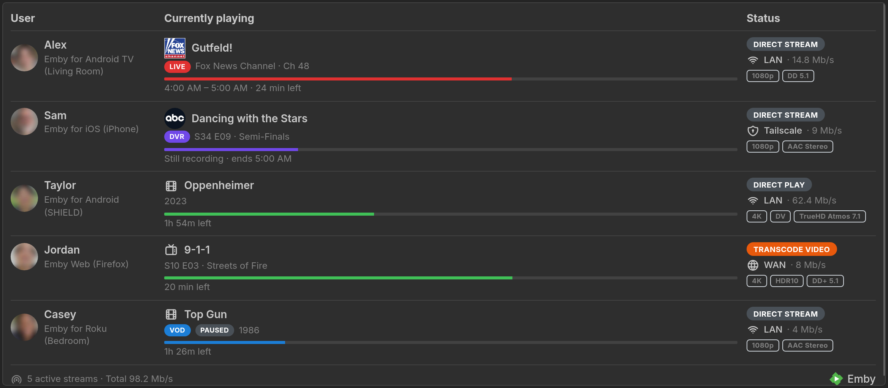
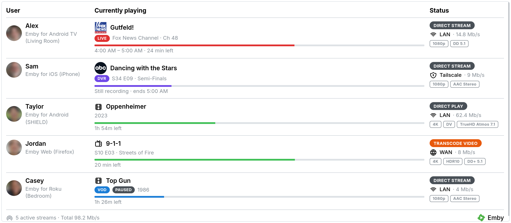
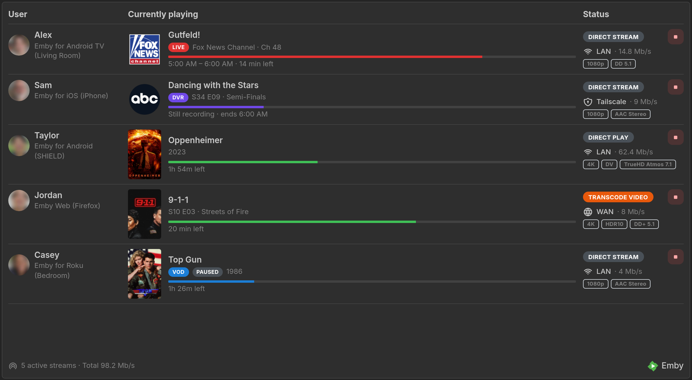
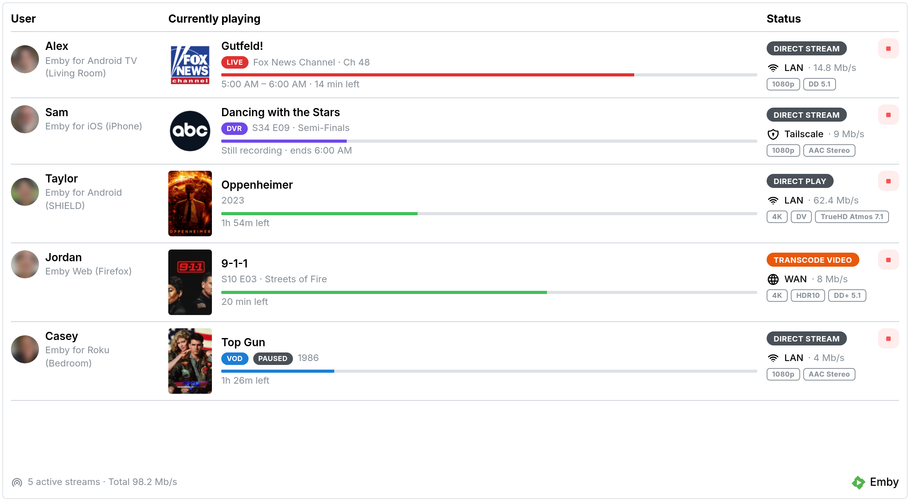
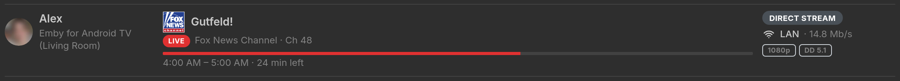
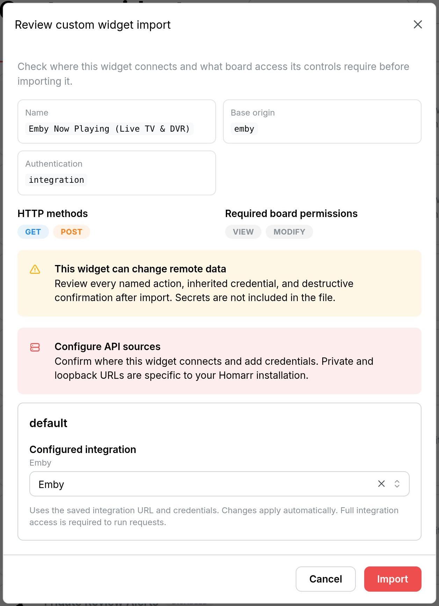
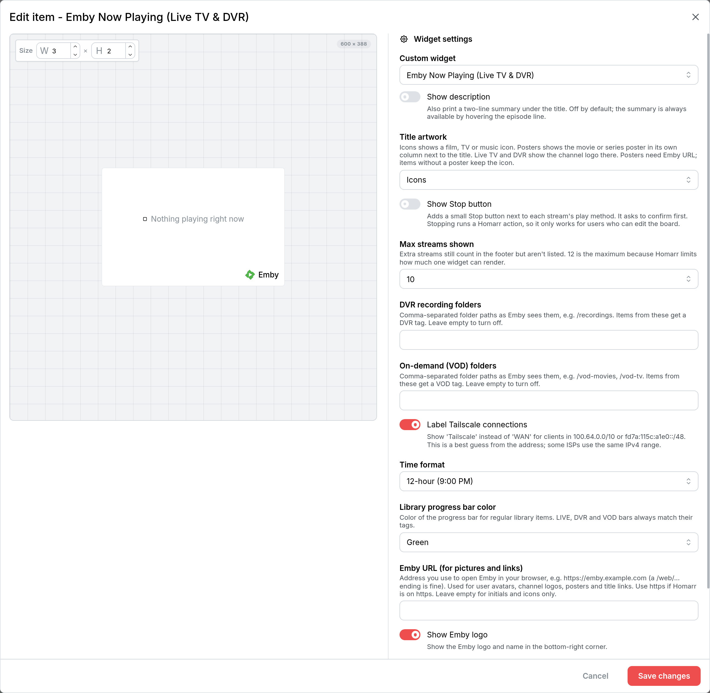

# Emby Now Playing (Live TV & DVR)

An Emby now playing widget for Homarr Custom Widgets that knows about Live TV, DVR and VOD.

**[Install from Homarr Workshop](https://homarr.dev/workshop/2irz1njw3rl48c0)** · [Download the manifest](widget.json)

## Screenshots

### Dark theme



### Light theme



### Optional posters and Stop button



### Posters in the light theme



### Live TV row



*Sample data with made-up users, not a live server. Avatars are blurred on purpose; the widget shows each user's Emby profile picture.*

## What it shows

- **Live TV:** the program airing on the channel (title, episode, time slot and progress), not just the channel name. The channel logo replaces the generic icon.
- **Optional posters:** set **Title artwork** to *Posters* to show a movie or series poster in its own column next to the title. Live TV and DVR rows show the channel logo in the same column.
- **Optional Stop button:** turn on **Show Stop button** for a small ■ button next to each stream's play method. It asks you to confirm before stopping.
- **DVR:** recordings get a purple **DVR** tag. A recording that is still in progress shows *Still recording · ends 9:00 PM* and uses its channel logo.
- **VOD:** items from your on-demand folders get a blue **VOD** tag.
- **Progress bars** use the same color as the tag: red for LIVE, purple for DVR, blue for VOD, green (or your theme color) for the regular library.
- **Play method:** Direct Play and Direct Stream stay gray. **REMUX** means only the container changed. Real transcoding turns orange and says **TRANSCODE AUDIO**, **TRANSCODE VIDEO** or **TRANSCODE A/V**. Hover the badge to see what is copied or converted, hardware or software, and Emby's reason.
- **Specs:** resolution (4K, 1440p, 1080p, 720p…), HDR (DV, HDR10+, HDR10, HLG) and audio format (for example DD+ 5.1, TrueHD Atmos 7.1, AAC Stereo) as small chips. If Emby is converting the audio, the chip shows what the device receives.
- **Network:** LAN, WAN or Tailscale (optional) with an icon, plus the bitrate. IPv4 and IPv6 are both handled.
- **PAUSED** tag, user avatars (letter-circle fallback), the summary on hover of the episode line, and the title links to the item in Emby.
- Music shows artist and album.

## Requirements

- Homarr 2.x with Custom Widgets. Tested on Homarr 2.13.1 with Emby 4.11.
- Your Emby server set up as an integration in Homarr. The widget uses that integration, so there is no API key to paste into the widget.
- **Viewers need full access to the Emby integration.** Homarr only runs integration requests for signed-in users with full integration access, so the widget won't load for guests on public boards or for users with limited access. The built-in media server widget doesn't have this limit.
- For avatars, logos and links: an Emby address your **browser** can reach. Use `https` if Homarr is on `https`, or the browser may block the images.

## Install

1. Install from Workshop, or download `widget.json` and import it under **Management → Custom Widgets → Import**.
2. In the import review, scroll down to **Configured integration** and pick your Emby integration. **The Import button stays grayed out until you do.**

   The review also says *"This widget can change remote data"* and lists `POST` / `MODIFY`. That is only the optional Stop button. Its single action is `POST /Sessions/{id}/Playing/Stop`, it is off by default, and it always asks before stopping. Everything else is read-only (`GET /Sessions`).

   

3. On your board, choose **Add widget**, search for *Emby Now Playing*, and add it.
4. In the widget settings, fill in **Emby URL** (for avatars, logos and links) and, if you use them, your **DVR** and **VOD** folders. Set **Refresh interval** to about 10 seconds for a live feel (Homarr's default is 30).

   

5. Resize the tile. Homarr adds it small (3 × 2); about **6 wide × 3 tall** fits two or three streams without scrolling.

## Troubleshooting

| What you see | Fix |
| --- | --- |
| Import button is grayed out | Scroll down in the import review and pick your Emby integration. |
| *Couldn't reach Emby* | Check that the widget's source is your Emby integration and that the integration's own test passes under **Management → Integrations**. |
| The widget is blank for some users | They need full access to the Emby integration. Guests on public boards can't use it. |
| Initials instead of avatars, no channel logos | Set **Emby URL** to an address your browser can open. If Homarr is on `https`, Emby must be too. |
| No DVR or VOD tags | Add your folders under **DVR recording folders** / **On-demand (VOD) folders**. Use the paths Emby shows in the item's *Media info*. |
| *Error · Try again* on the tile **in edit mode** after updating the widget | A new version added a setting your tile doesn't have yet. Open the tile's **Edit item** and click **Save changes** once. The board works normally outside edit mode. |
| Two "Emby Now Playing" entries in the picker | Importing again creates a second copy instead of updating. Delete the old one under **Management → Custom Widgets**. |
| Stop says it couldn't stop the stream | The stream already ended, or you don't have edit permission on the board. Stop is an action, and Homarr only lets board editors run actions. |
| Badges all one color | Your board's custom CSS is overriding badge colors. See Custom CSS below. |

## Options

| Option | Default | What it does |
| --- | --- | --- |
| Show description | Off | Prints a two-line summary under the title. The summary is always available by hovering the episode line. |
| Title artwork | Icons | *Icons* shows a film, TV or music icon. *Posters* shows the movie or series poster in its own column (needs Emby URL; items without a poster keep the icon). Live TV and DVR show the channel logo there. Poster rows are a little taller, so give the tile an extra row if you usually have 4+ streams. |
| Show Stop button | Off | Adds a small ■ Stop button next to each stream's play method, with a confirm step. Stopping is a Homarr *action*, so it only works for users who can edit the board; others get an error message. |
| Max streams shown | 10 | Lists up to this many streams (5, 8, 10 or 12). Extra streams still count in the footer, e.g. *8 active streams (+3 more not shown)*. |
| DVR recording folders | Empty | Comma-separated folders as Emby sees them, e.g. `/recordings`. Items from these get the DVR tag. |
| On-demand (VOD) folders | Empty | Comma-separated folders, e.g. `/vod-movies, /vod-tv`. Items from these get the VOD tag. |
| Label Tailscale connections | On | Shows *Tailscale* instead of *WAN* for `100.64.0.0/10` and `fd7a:115c:a1e0::/48` addresses. A best guess from the address; some ISPs use the same IPv4 range. |
| Time format | 12-hour | 12-hour (9:00 PM) or 24-hour (21:00) for live TV and recording times. |
| Library progress bar color | Green | Green, or your board's theme color. LIVE, DVR and VOD bars always match their tags. |
| Emby URL | Empty | The address you use to open Emby, e.g. `https://emby.example.com`. A `/web/...` ending is fine. Used for avatars, channel logos, posters and title links. Leave empty for initials and icons only. |
| Show Emby logo | On | Emby logo and name in the bottom-right corner. |

## Custom CSS

Custom widgets can't use CSS class names, so the main parts have `data-emby-np` attributes you can target from your board's custom CSS:

| Selector | Element |
| --- | --- |
| `[data-emby-np="header"]` | Column header row |
| `[data-emby-np="row"]` | One stream. Also has `data-type="live"`, `"dvr"`, `"vod"` or `"library"` |
| `[data-emby-np="title"]` / `[data-emby-np="title-link"]` | Title text / its link |
| `[data-emby-np="tag"]`, `[data-emby-np="paused"]` | LIVE / DVR / VOD tag, PAUSED tag |
| `[data-emby-np="play-method"]` | Direct Play / Direct Stream / Remux / Transcode badge |
| `[data-emby-np="spec"]` | Resolution, HDR and audio chips |
| `[data-emby-np="poster"]` | Poster (Title artwork: Posters) |
| `[data-emby-np="art-slot"]` | Poster / channel-logo column (Title artwork: Posters) |
| `[data-emby-np="progress"]`, `[data-emby-np="progress-fill"]` | Progress track and fill |

Example: a thicker progress bar on live TV rows only.

```css
[data-emby-np="row"][data-type="live"] [data-emby-np="progress"],
[data-emby-np="row"][data-type="live"] [data-emby-np="progress-fill"] {
  height: 6px !important;
}
```

Colors use Homarr's theme variables, so light and dark themes work without extra CSS.

## Known limits

- One Emby server per widget.
- Up to 12 listed streams. Homarr caps how much work one widget can do per render; in testing, 16 of the heaviest rows still rendered and 20 did not, so 12 leaves headroom.
- The resolution chip shows the source file, not the transcoded output.
- English labels only.
- Hover details use the browser's tooltip, so they don't appear on touch screens.
- Text and artwork keep a fixed, readable size (they follow Homarr's own scale setting and browser zoom). On narrower tiles the columns tighten and long text truncates; on very narrow tiles and phones the layout wraps. If more streams are playing than the tile is tall, the list scrolls.
- Emby only. Plex and Jellyfin aren't supported.

## Credits

- Emby logo from [homarr-labs/dashboard-icons](https://github.com/homarr-labs/dashboard-icons).

## License

MIT
